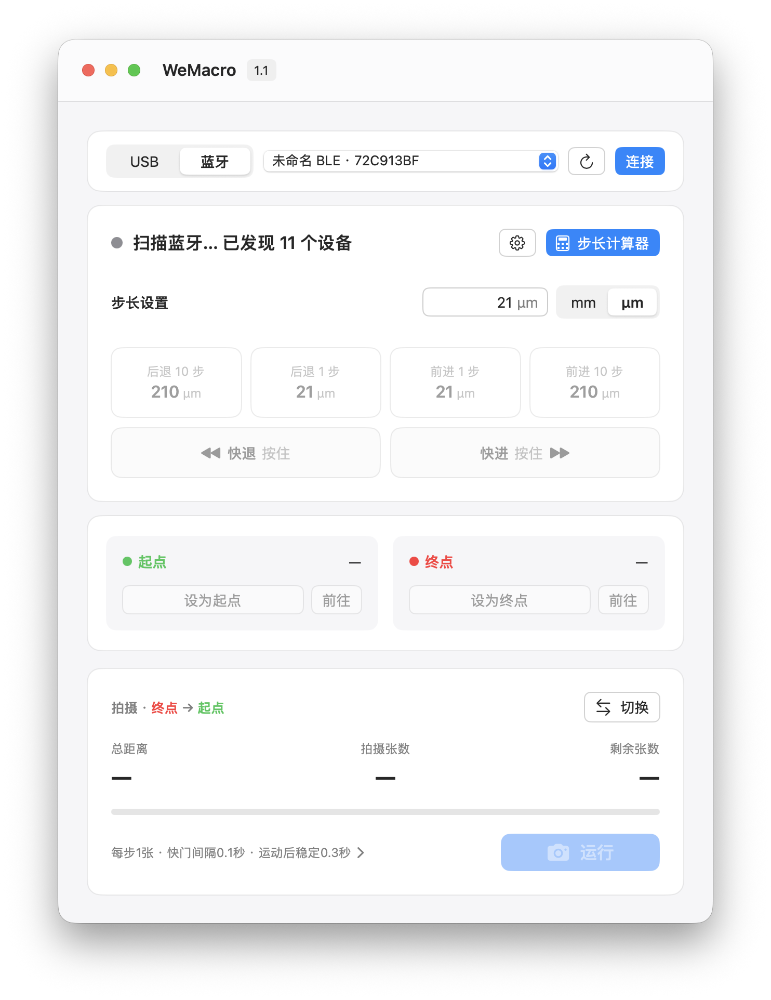
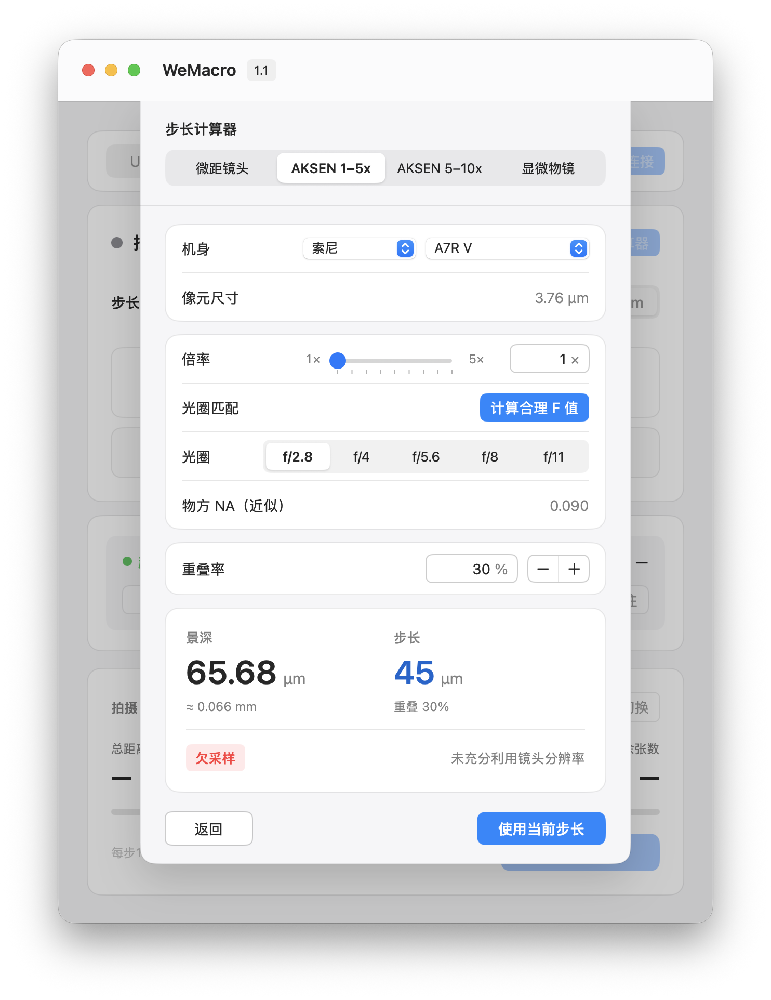
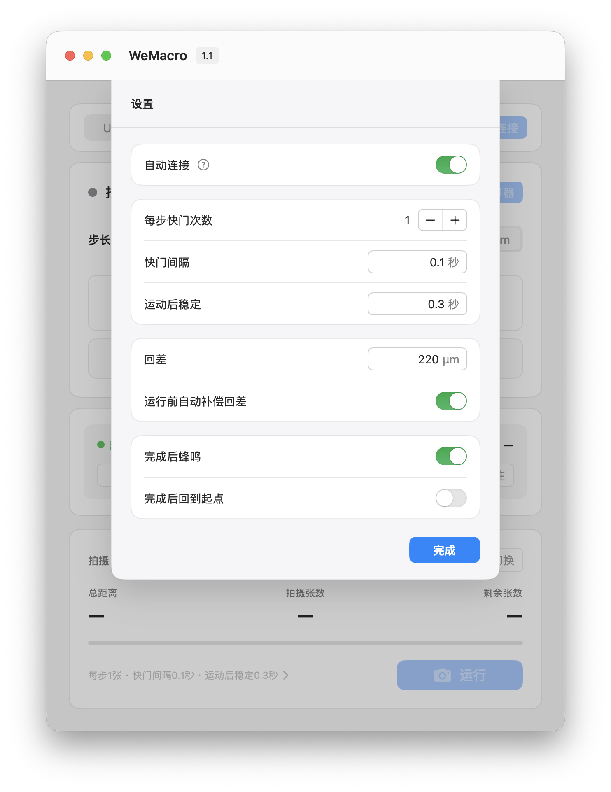

# WeMacro 1.1 Beta 2（GPLv3）

原生 macOS 电动滑轨控制程序，支持 USB 串口、HC-08 BLE 和离线模拟设备，内置景深与步长计算器。

## 开源许可证与源码

本版正式采用 **GPLv3（GPL-3.0-only）** 开源，Copyright © 2026 m1ll3t。

- [完整许可证](https://github.com/m1ll3t/WeMacroMac/blob/v1.1.0-beta.2/LICENSE)
- [下载本版对应源码](https://github.com/m1ll3t/WeMacroMac/releases/download/v1.1.0-beta.2/WeMacro-1.1-source.zip)
- 应用包内附 `LICENSE.txt`、`NOTICE.txt`、`SOURCE.txt`。
- 允许使用、修改、分发和商用；分发时应遵守 GPLv3 的源码与许可要求。本项目不提供任何担保。

本次更新加入开源许可和源码分发信息，控制功能与 Beta 1 相同。

## 本版新增

- 拍摄中可打开计算器查看和计算，运行期间禁止应用新步长。
- 上下方向键短按一步、按住按当前步长和速度连续步进。
- 扩展 Page Up/Down、Home/End、Shift+Home/End、Delete 和 Insert 控制。
- 运动中按钮保留按压反馈，忽略新控制操作，不发送或排队。
- 只设置起点或终点并移动后即可运行，自动补齐另一端点。

## 下载与系统要求

下载 `WeMacro-1.1-AppleSilicon.zip` 并解压。需要 macOS 14+ 和 Apple Silicon（M 系列芯片）。Intel Mac 可自行从源码构建，但本次未提供 Intel 预编译包。

本应用为第三方独立开发，与 WeMacro 官方没有隶属关系。应用采用本地签名，未经过 Apple 公证。

## 验证范围

整理后的独立工程通过 18 项控制器/模拟流程测试与 12 项光学计算测试。设备蜂鸣已由开发使用者实机确认。本次发布准备未重新运行真实滑轨或相机。

进度和剩余张数按已发送的快门指令计数，不代表已确认相机保存成功。连续快速移动中途停止的位置按时间估算，软件不提供物理限位保证。

## 界面截图

| 主界面 | 步长计算器 | 设置 |
| --- | --- | --- |
|  |  |  |
